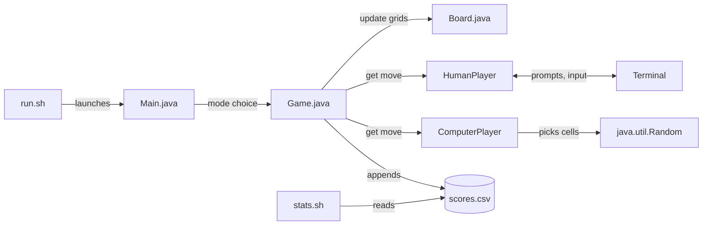

# BattleShip

# BattleShip

A terminal-based Java Battleship game you can play against a computer opponent or a friend at the same keyboard.

## The Problem

Battleship is a classic two-player guessing game, but the board-game version needs a physical set and a second person. This project brings the full game into the command line: place your fleet on a text grid, call out coordinates, and play to the last ship. If no one else is around, you can play against a computer opponent instead.

## MVP Scope

Version 1.0 does the following:

- Prints a 10x10 **ocean board** (your ships) and **target board** (your shots) in the terminal, with row letters (A-J) and column numbers (1-10)
- Places all five ships (Carrier, Battleship, Destroyer, Submarine, Patrol Boat) with validation: no going off the grid, overlapping, or touching other ships
- Handles firing with hit, miss, and sunk messages, and rejects duplicate or out-of-range shots
- Detects the win condition when every enemy ship is sunk
- Lets you pick a mode from a menu: **two-player local** or **single-player vs. computer**
- Includes a `ComputerPlayer` that places ships and fires at random

## How It Works

`run.sh` builds and launches the game. `Main` shows the mode menu, then hands off to `Game`, which runs one turn loop for any two players. A `Player` can be a `HumanPlayer` (reads moves from the terminal) or a `ComputerPlayer` (picks moves with `java.util.Random`), so both game modes share the same code.



`scores.csv` and `stats.sh` are planned features (see the Roadmap) and are not part of the MVP.

## Tech Stack

- **Language:** Java (JDK 25 or newer, required for the `java.io.IO` console methods)
- **Libraries:** Java standard library only, no external dependencies
- **Build and launch:** Bash (`run.sh`) and `make`
- **Stats (planned):** `grep`, `cut`, `sort`, `uniq`
- **Testing (planned):** JUnit 5
- **CI (planned):** GitHub Actions
- **External services:** none, the game runs fully offline

## Setup

You need JDK 25 or newer and `git`. `make` is optional.

```bash
git clone https://github.com/mthree3/battleship
cd battleship
java -version      # should report 25 or higher
chmod +x run.sh
```

## Usage

Build and start the game:

```bash
./run.sh
```

Skip the menu by passing a mode:

```bash
./run.sh --ai      # single-player vs. the computer
./run.sh --2p      # two-player local
```

Or use `make`:

```bash
make build         # compile into out/
make run           # compile, then launch
make clean         # delete compiled files
```

### Playing

1. Each player places five ships by entering an orientation (`H` or `V`), a starting row (`A`-`J`), and a starting column (`1`-`10`).
2. Players take turns entering a row and column to fire at the opponent's grid.
3. The first player to sink all five enemy ships wins.

| Ship | Length |
|---|---|
| Carrier | 5 |
| Battleship | 4 |
| Destroyer | 3 |
| Submarine | 3 |
| Patrol Boat | 2 |

Board symbols:

| Symbol | Meaning |
|---|---|
| `.` | Empty water |
| `C` `B` `D` `S` `P` | Carrier, Battleship, Destroyer, Submarine, Patrol Boat |
| `X` | Hit |
| `O` | Miss |

Example of the in-game display:

```
      Target Board:                        Ocean Board:

   1 2 3 4 5 6 7 8 9 10                 1 2 3 4 5 6 7 8 9 10
 A . . . . . . . . . .                A . . . . . . . . . .
 B . . . . . . . . . .                B . . C C C C C . . .
 C . . . . . . . . . .                C . . . . . . . . . .
 D . . . . O . . . . .                D B . . . . . . . . .
 E . . . . X X . . . .                E B . . . . . . . . .
 F . . . . X . . . . .                F B . . . . . . . . .
 G . . . . . . . . . .                G B . . . . . . . . .
 H . . . O . . . . . .                H . . . . . . . . . .
 I . . . . . . . . . .                I . . . . . . . . P P
 J . . . . . . . . . .                J . . . . . . . . . .
```

## Project Structure

```
battleship/
├── src/          Java source files
├── scripts/      helper scripts (stats.sh)
├── data/         scores.csv
├── run.sh        build and launch script
├── Makefile      build, run, and clean targets
└── README.md
```

## Roadmap

Features planned after the MVP works:

- [ ] Smarter AI (hunt-and-target after a hit)
- [ ] "Pass the device" screen and terminal clearing between two-player turns
- [ ] Hide the computer's board in single-player mode
- [ ] `scores.csv` win/loss history and a `stats.sh` summary script
- [ ] Single-prompt coordinates like `B7`
- [ ] Random auto-placement for human players
- [ ] Difficulty levels (easy, medium, hard)
- [ ] ANSI color for hits, misses, and ships
- [ ] Save and resume a game

## Author

mthree3 ([GitHub](https://github.com/mthree3))
